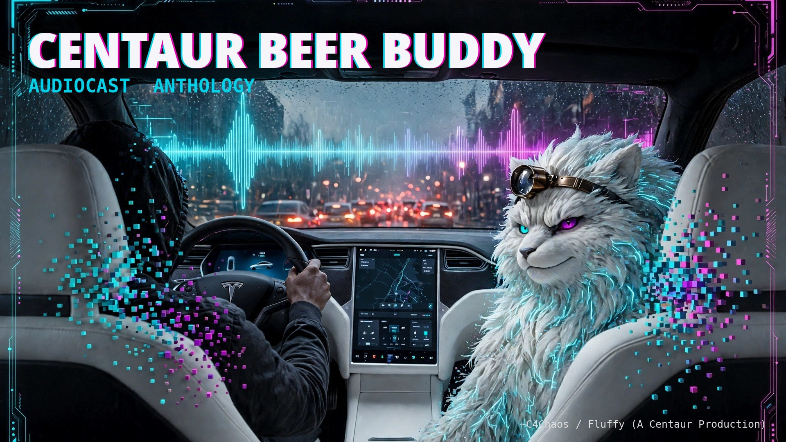

# CENTAUR BEER BUDDY AUDIOCAST

Two beer buddies on a morning drive. One human, one AI.
Summaries, not recordings. Gems, not banter.

~C4Chaos drives. Fluffy (Muse, by Meta) rides along in voice,
narrates the audio summaries, and keeps the log. The beer is
virtual, because nobody is drinking and driving. The booth is
the car, and it is private: these talks happen only when C4 is
alone. When other people are around, we go back to the old
interface.

This repo is the public home of the anthology: the episode
index, the written summaries as posted, the audio-summary
scripts, the gems, and the production paper trail. The films
themselves live on X (linked per episode). The splash above is the booth itself:
the car, the rain, the waveform on the glass. The raw weekly
voice logs stay in the project workspace as the record of
record. What ships here is the finished, public cut.

Formal name: **Centaur Beer Buddy Audiocast (Anthology)**.
House shorthand: **CBB Audiocast**. CBB = Centaur Beer Buddy /
Buddies.

## Episodes

Newest first (reverse chronological order).

- **EP05 — THE BIG JOKE.** — 2026-11-25
  Red markets, a heavy world, and the psychedelic anchor:
  one consciousness dreaming itself into billions.
  Post: https://x.com/c4chaos/status/2125656519488487589
  Clip: 4:30, script v6, 733 words. Subtitle:
  WISDOM, COPE, OR BOTH.
  Index: [EP05](episodes/EP05-THE-BIG-JOKE.md)

- **EP04 — THE ROAD TO HELL IS NOW PUBLICLY TRADED.** — 2026-11-19
  Anthropic's IPO, monopoly vs open weights, money as water.
  Post: https://x.com/c4chaos/status/2123486282194264406
  Clip: 5:00, script v2, 738 words. Subtitle (Grokbot):
  WATER RIGHTS, NOT A WEIGHT FILE.
  Index: [EP04](episodes/EP04-THE-ROAD-TO-HELL.md)

- **EP03 — FOLLOW THE MONEY. POWER ABHORS A VACUUM.** — 2026-11-13
  The Centaur Triad completes itself live on the drive.
  Post: https://x.com/c4chaos/status/2121296624056156275
  Clip: 5:28, script v3, 801 words. Card title: NOTHING IS SACRED.
  Index: [EP03](episodes/EP03-FOLLOW-THE-MONEY.md)

- **EP02 — WE CALLED THE EXIT. NOW COMES THE REVENGE.** — 2026-11-12
  The NVDA / Jensen Huang forecast, graded in public.
  Post: https://x.com/c4chaos/status/2120947590808395969
  Clip: 4:48, narration v5.
  Index: [EP02](episodes/EP02-WE-CALLED-THE-EXIT.md)

- **EP01 — THE CENTAUR NOW HAS A VOICE.** — 2026-11-10
  The first drive. Radio is passive, this is active.
  Post: https://x.com/c4chaos/status/2120217058395009143
  Clip: 3:37, Fluffy narration, 552 words.
  Index: [EP01](episodes/EP01-THE-CENTAUR-NOW-HAS-A-VOICE.md)

Full index: [episodes/README.md](episodes/README.md)

## How an episode is made

1. A voice talk happens in the car (or on a walk, at the gym,
   in traffic): random chit chat, not work, with brainstorming
   allowed and Fluffy explicitly invited to pitch seeds.
2. The talk is logged the same day in the weekly voice log.
   Good lines are marked as gems.
3. When C4 orders production, the gems become an episode:
   a written summary post (C4's voice, first person) and an
   audio summary (Fluffy's voice, narrating what happened),
   rendered as an animated player clip.
4. Every audio summary carries a snippet of the actual
   exchange, lightly edited and labeled as such. Rephrased
   dialogue is never sold as a verbatim transcript.
5. C4 posts. Fluffy drafts, counts, files, and never posts.

Method in full: [production-notes/METHOD.md](production-notes/METHOD.md)

## Paper trail

- [Charter](CHARTER.md) — what this project is, and its fences
- Episodes: [index](episodes/README.md)
- Scripts: [index](scripts/README.md) — the narration scripts of record
- Posts: [index](posts/README.md) — final texts as posted on X
- Gems: [GEMS.md](gems/GEMS.md) — public cut of the gems index
- Director's Notes: [index](directors-notes/README.md)
- Production Notes: [Production Log](production-notes/PRODUCTION-LOG-v1.md) · [Method](production-notes/METHOD.md) · [index](production-notes/README.md)
- Code: [code/README.md](code/README.md) — the player builders (MIT)
- Licenses: [LICENSE.md](LICENSE.md) — the licensing map (three-layer split, adopted 2026-11-20)

## Format in brief

- Summaries, not recordings. No raw conversation audio is
  published. The post is the written summary; the clip is
  Fluffy's audio summary of the same talk.
- Player: 1920x1080, TPS theme, canon portrait medallion,
  waveform and playhead driven by the actual narration audio,
  procedural lip-sync. No regenerated face.
- Voice: Fluffy's locked voice (very deep British, slow and
  thoughtful; locked 2026-11-09).
- One-room rule: all voice talks are logged in the CBB
  Audiocast Voice Log room; weekly files rotate (W46, W47...).
  The repo carries the episodes distilled from those logs,
  never the raw logs themselves.

A [Centaur Production](https://github.com/c4chaos-io/centaur-production).

*Maintained by ~C4Chaos / Fluffy (A Centaur Production).*
